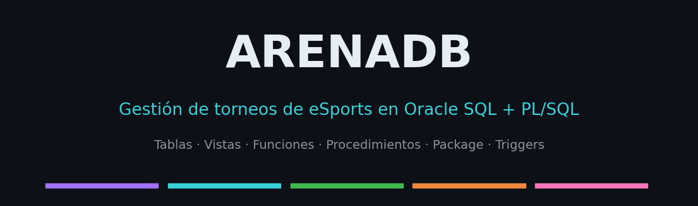
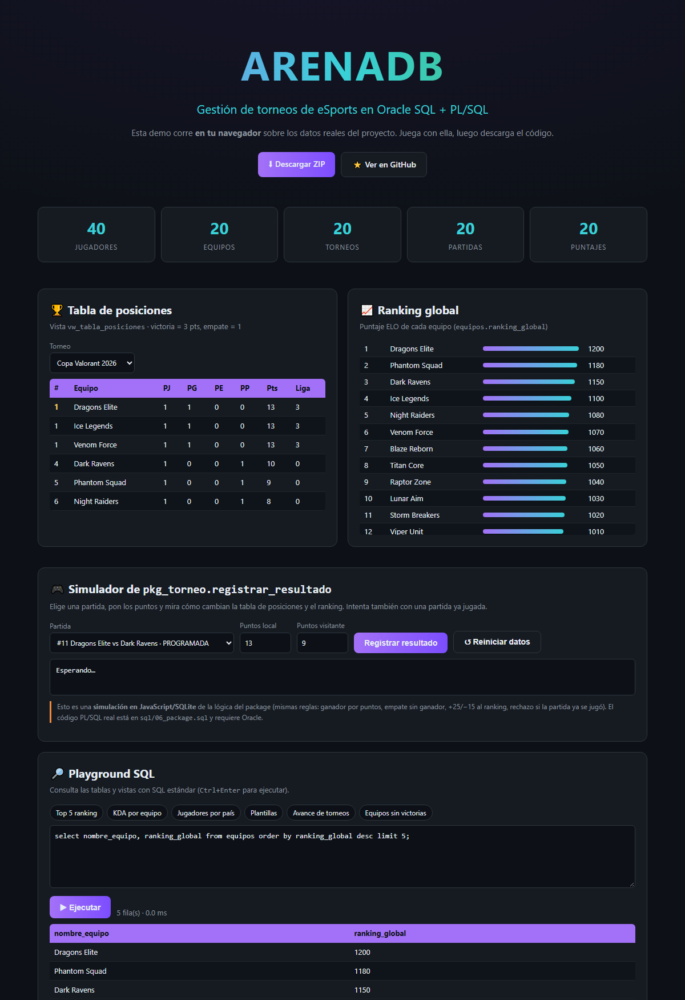
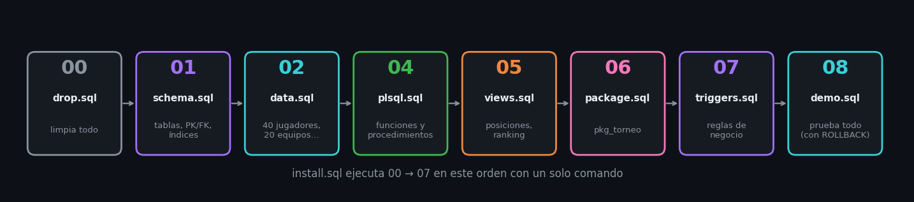
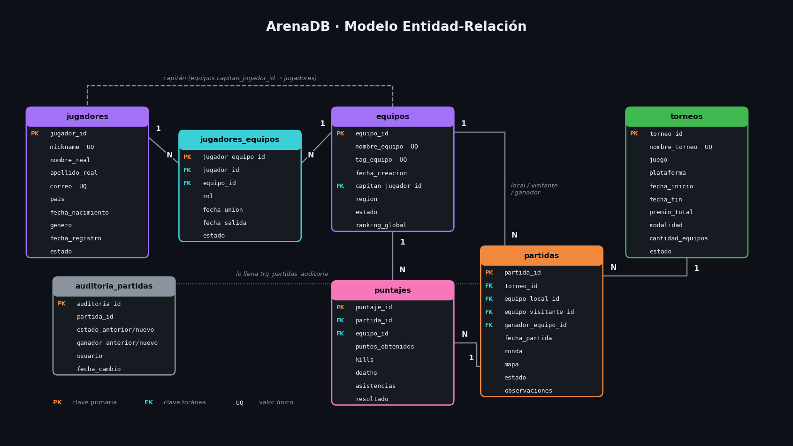
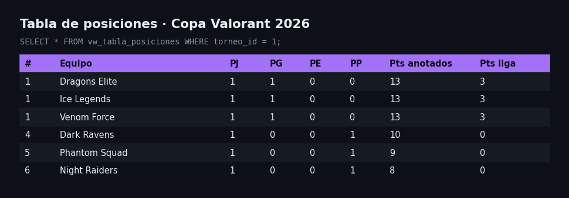
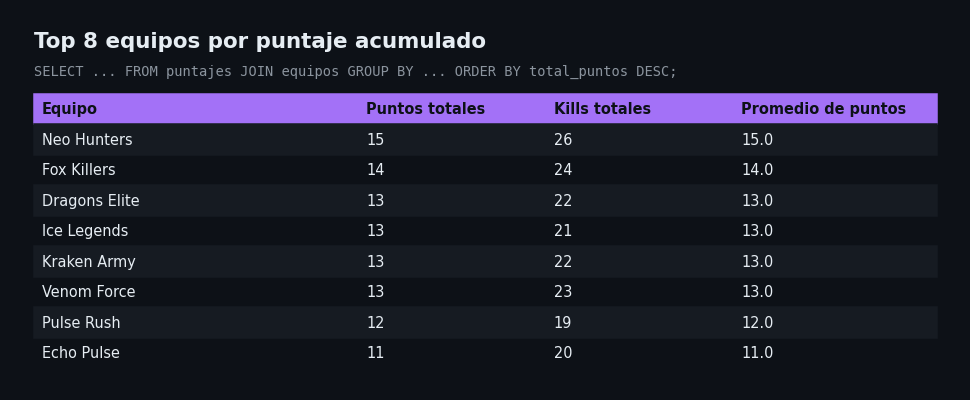
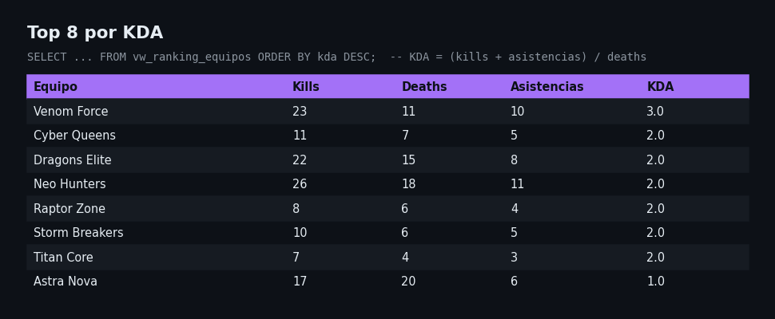
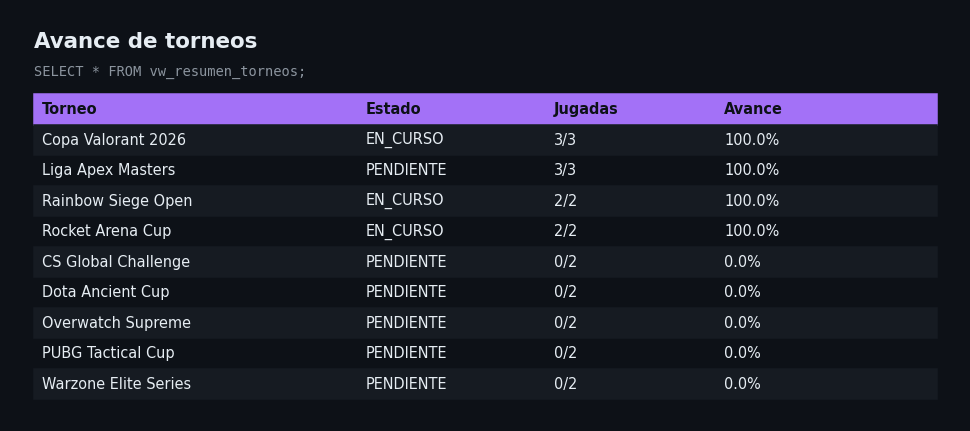

<p align="center">
  
</p>

<p align="center">
  
  
  
  
</p>

# 🎮 ArenaDB — Torneos de eSports en Oracle PL/SQL

Sistema completo para gestionar **torneos de eSports** directamente en la base de datos Oracle:
jugadores, equipos, torneos, partidas, puntajes, tabla de posiciones y ranking global.
Toda la lógica de negocio vive en PL/SQL (funciones, procedimientos, un *package* y *triggers*),
así que cualquier aplicación —o simplemente SQL\*Plus— obtiene las mismas reglas.

Es un proyecto **educativo y libre (MIT)**: pensado para aprender modelado relacional y PL/SQL con un
caso entretenido, o como punto de partida para tu propio sistema de torneos.

---

## ▶️ Pruébalo ahora (sin instalar nada)

<p align="center">
  <a href="https://nibrill.github.io/arenadb-oracle-plsql/"><b>👉 Abrir la demo interactiva 👈</b></a>
</p>

<p align="center">
  <a href="https://nibrill.github.io/arenadb-oracle-plsql/"></a>
</p>

La demo corre **100 % en tu navegador** con los datos reales del proyecto: tabla de posiciones por torneo,
ranking global, un **simulador** de `pkg_torneo.registrar_resultado` (mira cómo se mueve el ranking, y cómo se
rechaza una partida ya jugada) y un **playground SQL** con consultas listas.
Es una réplica en SQLite/JavaScript para poder jugar sin Oracle; el código PL/SQL real está en `sql/`.

---

## 📑 Contenido

- [Pruébalo ahora](#️-pruébalo-ahora-sin-instalar-nada)
- [¿Qué aprenderás con este proyecto?](#-qué-aprenderás-con-este-proyecto)
- [Instalación rápida](#-instalación-rápida)
- [Modelo de datos](#-modelo-de-datos)
- [Estructura del repositorio](#-estructura-del-repositorio)
- [Consultas SQL (con resultados)](#-consultas-sql-con-resultados)
- [Vistas](#-vistas)
- [PL/SQL: funciones y procedimientos](#-plsql-funciones-y-procedimientos)
- [El package `pkg_torneo`](#-el-package-pkg_torneo)
- [Triggers: reglas de negocio](#-triggers-reglas-de-negocio)
- [Demo paso a paso](#-demo-paso-a-paso)
- [Cómo contribuir](#-cómo-contribuir)
- [Licencia](#-licencia)

---

## 🧠 ¿Qué aprenderás con este proyecto?

| Tema | Dónde verlo |
|---|---|
| Modelado relacional (1:N, N:M, claves foráneas, `CHECK`, `UNIQUE`) | `sql/01_schema.sql` |
| Columnas `IDENTITY`, índices sobre FKs, `COMMENT ON` | `sql/01_schema.sql` |
| `JOIN`, `GROUP BY`, `HAVING`, `NOT EXISTS`, `LISTAGG` | `sql/03_queries.sql` |
| Funciones analíticas: `RANK() OVER`, `ROW_NUMBER() OVER` | `sql/03_queries.sql`, `sql/05_views.sql` |
| Vistas | `sql/05_views.sql` |
| Funciones, procedimientos, cursores, `%TYPE`, `%ROWTYPE` | `sql/04_plsql.sql` |
| Excepciones propias y `RAISE_APPLICATION_ERROR` | `sql/04_plsql.sql`, `sql/06_package.sql` |
| *Packages*, `RECORD`, `REF CURSOR`, `BULK COLLECT` | `sql/06_package.sql` |
| Transacciones: `SAVEPOINT`, `ROLLBACK TO`, `SELECT … FOR UPDATE` | `sql/06_package.sql` |
| Triggers de validación y auditoría | `sql/07_triggers.sql` |

---

## 🚀 Instalación rápida

### Requisitos
- Oracle Database 12c o superior (usa columnas `IDENTITY` y `FETCH FIRST`).
  Puedes usar la gratuita **Oracle Database Free** o **XE**.
- Un usuario con permisos para crear tablas, vistas, procedimientos, paquetes y triggers.
- SQL\*Plus, SQLcl o SQL Developer.

### Con un solo comando

```bash
git clone https://github.com/nibrill/arenadb-oracle-plsql.git
cd arenadb-oracle-plsql
sqlplus usuario/clave@//localhost:1521/FREEPDB1 @sql/install.sql
```

> En **SQL Developer**: abre `sql/install.sql` y presiona **F5** (*Run Script*).

`install.sql` ejecuta todos los scripts en el orden correcto y es **re-ejecutable**: empieza borrando los
objetos del proyecto (`00_drop.sql`), así que puedes reinstalar cuando quieras.

<p align="center">
  
</p>

### Probar con Docker (opcional)

```bash
docker run -d --name oracle-torneo -p 1521:1521 -e ORACLE_PASSWORD=torneo123 gvenzl/oracle-free:slim-faststart
# espera a que diga "DATABASE IS READY TO USE!" (docker logs -f oracle-torneo)
sqlplus system/torneo123@//localhost:1521/FREEPDB1 @sql/install.sql
```

Después prueba:

```sql
@sql/08_demo.sql      -- demo de la lógica de negocio (termina con ROLLBACK, no ensucia los datos)
@sql/03_queries.sql   -- las 22 consultas de ejemplo
```

---

## 🗄️ Modelo de datos

<p align="center">
  
</p>

| Tabla | Propósito |
|---|---|
| `jugadores` | Personas registradas (nickname único, correo único, país, estado). |
| `equipos` | Equipos con tag único, región, capitán y `ranking_global` (puntaje tipo ELO). |
| `jugadores_equipos` | Relación **N:M** jugador ↔ equipo, con rol (`CAPITAN`, `JUGADOR`, `SUPLENTE`, `COACH`) y fechas. |
| `torneos` | Juego, plataforma, fechas, premio, modalidad (`SOLO`, `DUO`, `SQUAD`, `5V5`) y estado. |
| `partidas` | Enfrentamiento local vs visitante dentro de un torneo, con ronda, mapa, estado y ganador. |
| `puntajes` | Estadísticas de cada equipo en cada partida: puntos, kills, deaths, asistencias, resultado. |
| `auditoria_partidas` | Historial de cambios de estado/ganador (la llena un trigger). |

**Reglas de integridad que ya incluye el esquema**

- Una partida no puede enfrentar a un equipo contra sí mismo (`CHECK equipo_local_id <> equipo_visitante_id`).
- Un equipo solo puede tener un puntaje por partida (`UNIQUE (partida_id, equipo_id)`).
- `fecha_fin >= fecha_inicio` en torneos y `fecha_salida >= fecha_union` en membresías.
- Estados, roles, rondas y modalidades restringidos con `CHECK`.
- Índices sobre todas las claves foráneas.

> 📁 En `docs/` también están el modelo lógico/relacional original y la documentación bilingüe en PDF/DOCX
> (versión inicial del proyecto; el diagrama de arriba es el actualizado).

---

## 📂 Estructura del repositorio

```text
arenadb-oracle-plsql/
├── sql/
│   ├── install.sql      -- instala todo en orden
│   ├── 00_drop.sql      -- limpieza (permite reinstalar)
│   ├── 01_schema.sql    -- tablas, restricciones, índices, comentarios
│   ├── 02_data.sql      -- datos de ejemplo: 40 jugadores, 20 equipos, 20 torneos, 20 partidas…
│   ├── 03_queries.sql   -- 22 consultas SQL (básicas y avanzadas)
│   ├── 04_plsql.sql     -- funciones, procedimientos y bloques anónimos
│   ├── 05_views.sql     -- vw_tabla_posiciones, vw_ranking_equipos, vw_resumen_torneos
│   ├── 06_package.sql   -- package pkg_torneo
│   ├── 07_triggers.sql  -- validaciones y auditoría
│   └── 08_demo.sql      -- demo de todo lo anterior (con ROLLBACK)
├── docs/                -- demo web (index.html), diagramas e imágenes
├── tools/               -- build_demo.py: regenera docs/index.html desde los .sql
├── LICENSE.md
└── README.md
```

---

## 📊 Consultas SQL (con resultados)

`sql/03_queries.sql` trae 22 consultas. Algunos ejemplos con los datos de muestra:

### Tabla de posiciones de un torneo
Victoria = 3 puntos, empate = 1. Se calcula con `RANK() OVER (PARTITION BY torneo …)`.

```sql
SELECT * FROM vw_tabla_posiciones WHERE torneo_id = 1;
```



### Ranking de equipos por puntaje acumulado

```sql
SELECT e.nombre_equipo,
       SUM(pt.puntos_obtenidos) AS total_puntos
FROM puntajes pt
JOIN equipos e ON pt.equipo_id = e.equipo_id
GROUP BY e.nombre_equipo
ORDER BY total_puntos DESC, e.nombre_equipo;
```



### KDA por equipo
`KDA = (kills + asistencias) / deaths`



### Avance de cada torneo



> Las capturas muestran el resultado de estas consultas sobre los datos de `02_data.sql`.

---

## 👁️ Vistas

| Vista | Qué entrega |
|---|---|
| `vw_tabla_posiciones` | PJ / PG / PE / PP, puntos anotados, puntos de liga y posición por torneo. |
| `vw_ranking_equipos` | Ranking global + victorias, kills, deaths, asistencias y KDA por equipo. |
| `vw_resumen_torneos` | Partidas totales / jugadas / pendientes y porcentaje de avance. |

---

## ⚙️ PL/SQL: funciones y procedimientos

`sql/04_plsql.sql` (solo crea objetos y hace pruebas de **lectura**, así que es seguro ejecutarlo siempre):

| Objeto | Descripción |
|---|---|
| `fn_total_victorias_equipo(equipo_id)` | Cuenta las partidas jugadas ganadas por un equipo. |
| `fn_total_puntos_equipo(equipo_id)` | Suma de puntos acumulados. |
| `fn_categoria_premio(premio)` | Clasifica un torneo en `BAJO` / `MEDIO` / `ALTO` (función `DETERMINISTIC`). |
| `sp_actualizar_estado_torneo(id, estado)` | Cambia el estado; error `-20001` si no existe. |
| `sp_actualizar_estado_partida(id, estado)` | Cambia el estado; error `-20002` si no existe. |
| `sp_registrar_ganador_partida(partida, equipo)` | Valida que el ganador haya jugado la partida. |
| `sp_ranking_equipos` | Imprime el ranking con un cursor. |

```sql
SET SERVEROUTPUT ON
SELECT fn_categoria_premio(850000) FROM dual;                -- ALTO
SELECT fn_total_victorias_equipo(1) FROM dual;
EXEC sp_ranking_equipos;
```

---

## 📦 El package `pkg_torneo`

Agrupa la lógica de negocio. Es la forma recomendada de usar el sistema.

| Elemento | Descripción |
|---|---|
| `registrar_resultado(partida, local, visitante)` | Inserta los 2 puntajes, decide ganador (o empate), marca la partida `JUGADA` y mueve el ranking global (**+25 / −15**). Es **atómico**: usa `FOR UPDATE` y `SAVEPOINT` / `ROLLBACK TO`, así que si algo falla no queda nada a medias. |
| `tabla_posiciones(torneo)` | Devuelve la tabla como `SYS_REFCURSOR` (ideal para una app cliente). |
| `imprimir_posiciones(torneo)` | Imprime la tabla usando `BULK COLLECT`. |
| `cerrar_torneo(torneo)` | Finaliza un torneo solo si no quedan partidas programadas. |
| `t_stats` | `RECORD` con `puntos`, `kills`, `deaths`, `asistencias`. |
| `e_partida_no_programada`, … | Excepciones con nombre (`PRAGMA EXCEPTION_INIT`). |

Ejemplo:

```sql
SET SERVEROUTPUT ON
DECLARE
    v_local pkg_torneo.t_stats;
    v_visit pkg_torneo.t_stats;
BEGIN
    v_local.puntos := 13; v_local.kills := 24; v_local.deaths := 14; v_local.asistencias := 9;
    v_visit.puntos := 10; v_visit.kills := 17; v_visit.deaths := 24; v_visit.asistencias := 6;

    pkg_torneo.registrar_resultado(11, v_local, v_visit);
    COMMIT;
END;
/

EXEC pkg_torneo.imprimir_posiciones(1);
```

| Código de error | Significado |
|---|---|
| `-20101` | La partida no existe |
| `-20102` | La partida no está `PROGRAMADA` (ya se jugó o se canceló) |
| `-20103` | El torneo no existe |
| `-20104` | El torneo aún tiene partidas programadas |

---

## 🛡️ Triggers: reglas de negocio

Lo que un `CHECK` no puede expresar (porque involucra varias columnas/tablas) se resuelve con triggers:

| Trigger | Regla |
|---|---|
| `trg_partidas_validar` | El ganador debe ser el equipo local o el visitante; solo una partida `JUGADA` puede tener ganador. |
| `trg_partidas_auditoria` | Guarda en `auditoria_partidas` cada cambio de estado o ganador (quién y cuándo). |
| `trg_torneos_estado` | Un torneo `FINALIZADO` o `CANCELADO` no puede reabrirse. |
| `trg_je_fecha_salida` | Si un integrante pasa a `RETIRADO`, se completa `fecha_salida` automáticamente. |

---

## ▶️ Demo paso a paso

`sql/08_demo.sql` recorre todo: registra un resultado, muestra el movimiento de ranking, intenta operaciones
inválidas (y ve cómo se rechazan) y revisa la auditoría. **Termina con `ROLLBACK`**, así que la base queda
exactamente igual y puedes repetirlo cuando quieras.

1. Registrar el resultado de la partida 11 con `pkg_torneo.registrar_resultado`.
2. Ver cómo cambió `equipos.ranking_global`.
3. Reintentar la misma partida → `e_partida_no_programada`.
4. Imprimir la tabla de posiciones.
5. Intentar un ganador que no jugó → rechazado por el trigger.
6. Intentar reabrir un torneo finalizado → rechazado por el trigger.
7. Intentar cerrar un torneo con partidas pendientes → rechazado.
8. Consultar `auditoria_partidas`.

---

## 🗺️ Ideas para seguir

- Generar automáticamente el *fixture* (llaves/rondas) de un torneo.
- Tabla de premios por posición y procedimiento de reparto.
- Jugadores por partida (estadísticas individuales, MVP).
- Pruebas automáticas con [utPLSQL](https://utplsql.org/).
- Una API REST encima con [ORDS](https://www.oracle.com/database/technologies/appdev/rest.html).

---

## 🤝 Cómo contribuir

¡Las contribuciones son bienvenidas!

1. Haz un *fork* y crea una rama: `git checkout -b feat/mi-mejora`
2. Mantén el estilo: prefijos `fn_`, `sp_`, `vw_`, `trg_`, nombres en español, comentarios que expliquen el *por qué*.
3. Asegúrate de que `sql/install.sql` corre de principio a fin en una base limpia y que `08_demo.sql` sigue funcionando.
4. Abre un *pull request* describiendo el cambio.

También puedes abrir un *issue* con ideas, dudas o errores.

---

## 📜 Licencia

Distribuido bajo licencia **MIT**. Consulta [LICENSE.md](LICENSE.md).
